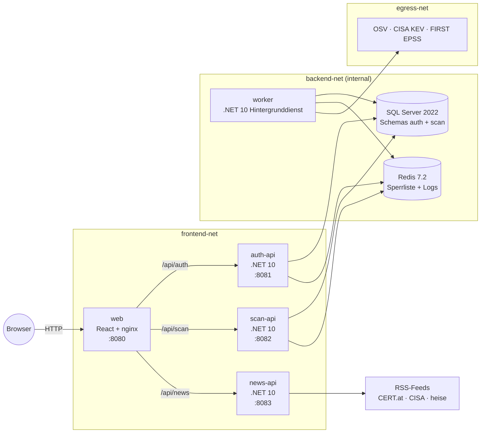
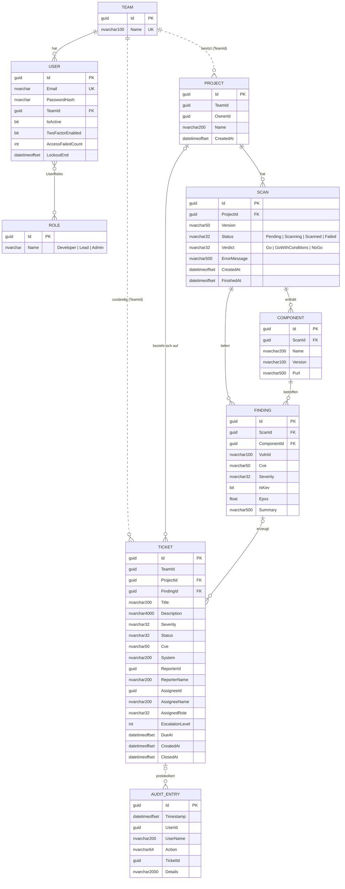
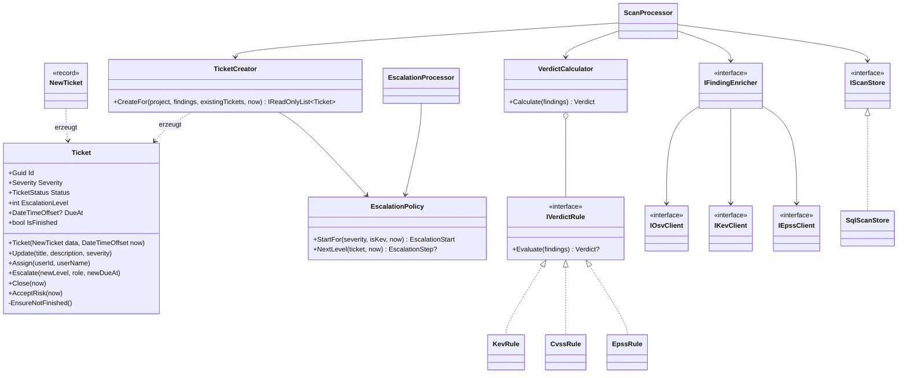

```text
               ______________
       _______/      /\      \_______
       |            /  \            |
       |           / /\ \           |
       |          / /  \ \          |
       |         / /    \ \         |
       |        <  [====]  >        |
       |         \ \    / /         |
       |          \ \  / /          |
       \           \ \/ /           /
        \           \  /           /
         \           \/           /
 __________________________________________
|    ____ __  __ ____  _     ____  ____    |
|   / ___|  \/  / ___|| |   |  _ \|  _ \   |
|  | |   | |\/| \___ \| |   | |_) | | | |  |
|  | |___| |  | |___) | |___|  __/| |_| |  |
|   \____|_|  |_|____/|_____|_|   |____/   |
|__________________________________________|
       \__                        __/
          \__                  __/
             \__            __/
                \__      __/
                   \____/
```
<p align="center">
  
</p>

# SIMS – Security Incident Management System

> **„Sul Sul, Exploit!“** – Sicherheitsvorfälle erfassen, bewerten, eskalieren und nachverfolgen.
> Ein Projekt von **Team CMSLPD**.


**Repository:** <https://github.com/r4nnd0m/ac_ProjectSeks>

---

## Inhaltsverzeichnis

1. [Überblick](#überblick)
2. [Features](#features)
3. [Architektur](#architektur)
4. [Systemvoraussetzungen](#systemvoraussetzungen)
5. [Installation und Start](#installation-und-start)
6. [Bedienung](#bedienung)
7. [REST-APIs](#rest-apis)
8. [Datenhaltung](#datenhaltung)
9. [Regeln: Scanurteil und Eskalation](#regeln-scanurteil-und-eskalation)
10. [Security-Maßnahmen](#security-maßnahmen)
11. [SAST und Abhängigkeitsprüfung](#sast-und-abhängigkeitsprüfung)
12. [Tests](#tests)
13. [Projektstruktur](#projektstruktur)
14. [Roadmap](#roadmap)
15. [Mitwirkende](#mitwirkende)
16. [Lizenz](#lizenz)

---

## Überblick

SIMS ist ein webbasiertes System zum Protokollieren und Bearbeiten von IT-Sicherheitsvorfällen.
Vorfälle (Tickets) entstehen auf zwei Wegen:

- **manuell** – ein Benutzer erfasst einen Vorfall mit Titel, Beschreibung, Schweregrad, CVE und betroffenem System;
- **automatisch** – ein Team lädt die **SBOM** (Software Bill of Materials, CycloneDX) eines eigenen Software-Projekts hoch.
  Ein Hintergrunddienst gleicht alle Komponenten mit öffentlichen Schwachstellen-Datenbanken
  (**OSV**, **CISA KEV**, **FIRST EPSS**) ab, fällt ein **Go / Go mit Auflagen / No-Go-Urteil** und legt für
  relevante Funde selbstständig Tickets an.

Offene Tickets werden nach Fristablauf automatisch **eskaliert** (Entwickler → Lead → Admin).
Jede sicherheitsrelevante Aktion wird im **Audit-Log** festgehalten, technische Logmeldungen
aller Dienste landen zentral in **Redis**.

Das gesamte System läuft lokal vollständig in **Docker** (7 Container in 3 getrennten Netzen).

---

## Features

### Benutzer, Anmeldung und Rollen
| Funktion | Beschreibung |
| --- | --- |
| Anmeldung | E-Mail + Passwort, Ausgabe eines kurzlebigen JWT (15 min) |
| Zwei-Faktor (MFA) | TOTP per Authenticator-App (QR-Code im Frontend), zweistufiger Login |
| Abmelden | Token wird serverseitig in einer Redis-Sperrliste widerrufen |
| Rollen | `Developer`, `Lead`, `Admin` |
| Teams | Jeder Benutzer gehört zu einem Team; Projekte, Scans und Tickets sind teamgebunden |
| Benutzerverwaltung (Admin) | Benutzer anlegen, auflisten, deaktivieren (eigenes Konto ist geschützt) |
| Teamverwaltung (Admin) | Teams anlegen und auflisten |

### Vorfälle (Tickets)
| Funktion | Beschreibung |
| --- | --- |
| Erfassen | Titel, Beschreibung, Schweregrad (Low–Critical), CVE, System, Projekt, Melder, Zeitstempel |
| Bearbeiten | Titel, Beschreibung, Schweregrad ändern (solange nicht abgeschlossen) |
| Übernehmen | Ticket wird dem angemeldeten Benutzer zugewiesen → Status *InProgress* |
| Schließen | Status *Closed* mit Abschlusszeitpunkt |
| Risiko akzeptieren | Nur **Admin mit aktiver MFA** → Status *RiskAccepted* |
| Liste | Filter nach Status, Schweregrad, „mir zugewiesen“; serverseitiges Paging |
| Eskalation | automatisch nach Frist, 3 Stufen (siehe [Regeln](#regeln-scanurteil-und-eskalation)) |

**Ticket-Status:** `Open` → `InProgress` → `Escalated` → `Closed` / `RiskAccepted`

### Projekte und SBOM-Scans
| Funktion | Beschreibung |
| --- | --- |
| Projekte | Anlegen und Auflisten pro Team |
| SBOM-Upload | CycloneDX-JSON (max. 5 MB, max. 5 000 Komponenten) mit Versionsangabe |
| Validierung | Format, Name, Version, gültige PURL (`pkg:`), Duplikate; alle Fehler gesammelt als HTTP 400 |
| Scan | Worker übernimmt den Auftrag (`Pending → Scanning → Scanned / Failed`) |
| Anreicherung | OSV (Schwachstellen), CISA KEV (aktiv ausgenutzt), FIRST EPSS (Ausnutzungswahrscheinlichkeit) |
| Urteil | `Go`, `GoWithConditions`, `NoGo` |
| Ergebnis | Fundliste mit Komponente, CVE, Schweregrad, KEV-Kennzeichen und EPSS-Wert |
| Auto-Tickets | Für jeden Fund ab *Medium* oder mit KEV-Eintrag; bereits bestehende Tickets werden nicht doppelt angelegt |

### Weitere Funktionen
| Funktion | Beschreibung |
| --- | --- |
| Security-News | Aktuelle Warnungen aus CERT.at, CISA und heise Security (RSS/Atom), gecacht und bereinigt |
| Audit-Log (Admin) | Wer hat wann welches Ticket übernommen, geschlossen, eskaliert oder das Risiko akzeptiert |
| Logging | Alle Dienste schreiben Id, Timestamp, Loglevel, Service und Message in Redis |
| Dashboard | Überblick über offene Tickets, Schweregrade und letzte Scans |
| Hell/Dunkel-Theme | Umschaltbar im Frontend |
| Demo-Modus | Frontend kann ohne Backend mit Testdaten laufen (`VITE_USE_MOCKS=true`) |

---

## Architektur



### Container

| Container | Image / Technologie | Aufgabe | Netze | Port (nur Loopback) |
| --- | --- | --- | --- | --- |
| `web` | nginx-unprivileged + React/Vite-Build | Weboberfläche, Reverse Proxy zu den APIs | frontend | `127.0.0.1:8080` |
| `auth-api` | ASP.NET Core 10, Identity | Login, JWT, MFA, Benutzer, Teams | frontend, backend | `127.0.0.1:8081` |
| `scan-api` | ASP.NET Core 10, EF Core | Projekte, SBOM-Upload, Scans, Tickets, Audit | frontend, backend | `127.0.0.1:8082` |
| `news-api` | ASP.NET Core 10 | Security-News aus RSS-Feeds | frontend | `127.0.0.1:8083` |
| `worker` | .NET 10 Worker Service | Scan-Verarbeitung, Anreicherung, Urteil, Eskalation | backend, egress | – |
| `sql` | SQL Server 2022 | Relationale Datenbank | backend | lokal `127.0.0.1:1433`* |
| `redis` | Redis 7.2 (mit Passwort) | Token-Sperrliste, zentrales Log | backend | lokal `127.0.0.1:6379`* |

\* nur über `docker-compose.override.yml` für die lokale Entwicklung. Mit `-f docker-compose.yml` sind SQL und Redis ausschließlich im internen Netz erreichbar.

### Docker-Netze

| Netz | Typ | Zweck |
| --- | --- | --- |
| `frontend-net` | bridge | Web ↔ APIs, News-API ins Internet (Feeds) |
| `backend-net` | **internal** | APIs/Worker ↔ SQL/Redis, kein Internetzugang |
| `egress-net` | bridge | Nur Worker → OSV/KEV/EPSS |
| `local-tools-net` | bridge | Nur lokal (Override) für Visual Studio / `dotnet ef` |

### Microservices im Detail

- **Auth-API** – ASP.NET Core Identity mit eigenem `ApplicationUser` (Team, Aktiv-Flag). Stellt signierte JWTs mit `sub`, `name`, `role`, `team_id`, `mfa` und `jti` aus.
- **Scan-API** – Der fachliche Kern: Projekte, SBOM-Upload und -Parsing, Scan-Ergebnisse, Ticket-Workflow und Audit-Abfrage. Validiert die JWTs der Auth-API selbst (gemeinsamer Schlüssel) und prüft die Redis-Sperrliste.
- **News-API** – Liest RSS/Atom-Feeds, bereinigt Texte (`TextSanitizer`), cacht die Ergebnisse (`IMemoryCache`) und liefert sie öffentlich aus.
- **Worker** – Kein HTTP-Endpunkt. Drei Hintergrundjobs: `ScanPollingService` (Scans abarbeiten), `EscalationJob` (Fristen prüfen), `HeartbeatJob` (Lebenszeichen ins Log).

### Gemeinsame Bibliotheken

| Projekt | Inhalt |
| --- | --- |
| `Sims.Contracts` | Gemeinsame Konstanten: Rollen, Claim-Namen, Policies |
| `Sims.Shared` | Entities, `SimsDbContext`, Migrationen, Urteilsregeln, Eskalationspolitik, Ticket-Erzeugung, Audit |
| `Sims.Logging` | `ILogger`-Provider, der Logeinträge als JSON in eine Redis-Liste schreibt |

---

## Systemvoraussetzungen

| Komponente | Version | Wofür |
| --- | --- | --- |
| Betriebssystem | Windows 10/11, macOS oder Linux (x64/arm64) | – |
| Docker Desktop / Docker Engine | aktuell, mit Docker Compose v2 | **Pflicht** zum Starten |
| RAM | ≥ 4 GB frei für Docker (SQL Server benötigt ≥ 2 GB) | – |
| .NET SDK | 10.0 | nur für Entwicklung, Tests, Migrationen |
| .NET Runtime | ASP.NET Core Runtime 10.0 (im Container enthalten) | – |
| `dotnet ef` | 10.x | nur für manuelle Migrationen / SQL-Export |
| Node.js | LTS (≥ 20) | nur für Frontend-Entwicklung |
| Git | aktuell | – |
| Internetzugang | für Worker (OSV/KEV/EPSS) und News-API | – |

---

## Installation und Start

```powershell
git clone https://github.com/r4nnd0m/ac_ProjectSeks.git
cd ac_ProjectSeks

copy .env.example .env          # Linux/macOS: cp .env.example .env
# .env öffnen und ALLE Passwörter und den JWT-Schlüssel ersetzen!

docker compose up -d --build    # alle Container bauen und starten
```

Danach im Browser **<http://localhost:8080>** öffnen und mit dem Admin-Konto aus `.env` (`ADMIN_EMAIL` / `ADMIN_PASSWORD`) anmelden.

Beim ersten Start legen die APIs über **EF-Core-Migrationen** automatisch die Datenbank `sims` mit den Schemas `auth` und `scan` an und erstellen die Rollen, das Team „Default“ und das Admin-Konto (`MIGRATIONS_RUN=true`).

| Befehl | Wirkung |
| --- | --- |
| `docker compose ps` | Status aller Container |
| `docker compose logs -f worker` | Worker-Meldungen live |
| `docker compose stop` | Stoppen, Daten bleiben erhalten |
| `docker compose down` | Container entfernen (Volumes bleiben) |
| `docker compose down -v` | Alles inklusive Daten löschen |
| `docker compose -f docker-compose.yml up -d` | Start ohne lokale Freigabe von SQL/Redis |

### Konfiguration (`.env`)

| Variable | Bedeutung | Standard |
| --- | --- | --- |
| `MSSQL_SA_PASSWORD` | Passwort SQL Server | – (Pflicht) |
| `REDIS_PASSWORD` | Passwort Redis | – (Pflicht) |
| `JWT_KEY` | Signaturschlüssel, mind. 32 Zeichen | – (Pflicht) |
| `JWT_ISSUER` / `JWT_AUDIENCE` | Aussteller / Zielgruppe des Tokens | `sims-auth` / `sims-api` |
| `JWT_EXPIRES_MINUTES` | Gültigkeit des Tokens | `15` |
| `ADMIN_EMAIL` / `ADMIN_PASSWORD` | Erstes Admin-Konto | – |
| `CORS_ALLOWED_ORIGINS_0` | Erlaubter Browser-Ursprung | `http://localhost:8080` |
| `MIGRATIONS_RUN` | Migrationen beim Start ausführen | `true` |
| `WORKER_POLL_INTERVAL_SECONDS` | Abfrageintervall des Workers | `30` |
| `VERDICT_EPSS_NOGO_THRESHOLD` | EPSS-Grenze für No-Go | `0.5` |
| `ESCALATION_CRITICAL_HOURS` / `_HIGH_` / `_MEDIUM_` | Eskalationsfristen | `4` / `24` / `72` |
| `FEED_URL_1`, `FEED_URL_2` | RSS-Feeds der News-API | CERT.at, CISA |
| `NEWS_REFRESH_MINUTES` | Cache-Dauer der News | `30` |

### SQL-Skript für das Datenbankmodell

Das Datenmodell wird mit **Entity Framework Core (Code First + Migrationen)** verwaltet. Ein prüfbares, idempotentes SQL-Skript lässt sich jederzeit erzeugen:

```powershell
.\scripts\scan-db.ps1 -OutputSql .\scan-migration.sql
```

### Frontend ohne Backend (Demo-Modus)

```powershell
cd src/Web
npm install
npm run dev            # oder run-dev.bat – läuft mit Testdaten
```

---

## Bedienung

| Seite | Rolle | Inhalt |
| --- | --- | --- |
| `/login`, `/mfa` | alle | Anmeldung, ggf. zweiter Faktor |
| `/dashboard` | angemeldet | Kennzahlen, offene Tickets, letzte Scans |
| `/projects`, `/projects/:id` | angemeldet | Projekte des Teams, SBOM hochladen, Scan-Historie |
| `/scans/:id` | angemeldet | Urteil und Fundliste eines Scans |
| `/tickets`, `/tickets/:id` | angemeldet | Ticketliste mit Filtern, Detail, Übernehmen, Schließen, Risiko akzeptieren |
| `/mfa-setup` | angemeldet | Authenticator-App per QR-Code einrichten |
| `/admin/users` | Admin | Benutzer anlegen und deaktivieren |
| `/admin/teams` | Admin | Teams anlegen |
| `/admin/audit` | Admin | Audit-Log seitenweise |
| `/news` | öffentlich | Aktuelle Sicherheitsmeldungen |
| `/hinweise` | öffentlich | Übersicht der Endpunkte, Demo-Modus |

### Typischer Ablauf (Demo)

1. Als Admin anmelden, MFA einrichten, ab- und wieder anmelden (jetzt mit Code).
2. Team und einen Benutzer (`Developer`) anlegen.
3. Projekt anlegen und `Zusatz/test-sbom.json` als Version `1.0.0` hochladen.
4. Nach spätestens `WORKER_POLL_INTERVAL_SECONDS` zeigt der Scan das Urteil (z. B. **NoGo** wegen log4j / KEV).
5. In der Ticketliste erscheinen die automatisch erzeugten Tickets; eines übernehmen und schließen.
6. Manuelles Ticket erfassen, als Admin mit MFA das Risiko akzeptieren.
7. Im Audit-Log die Aktionen nachvollziehen; in Redis (`LRANGE logs 0 10`) die Logs ansehen.

---

## REST-APIs

Im Development-Modus liefern alle APIs eine **OpenAPI-Beschreibung** (`/openapi/v1.json`) und eine **Scalar-Oberfläche** (`/scalar`).
Über nginx sind sie unter `/api/auth`, `/api/scan` und `/api/news` erreichbar.

### Auth-API

| Methode | Pfad | Berechtigung | Beschreibung |
| --- | --- | --- | --- |
| POST | `/auth/login` | anonym, Rate Limit | Anmeldung; liefert Token oder MFA-Zwischentoken |
| POST | `/auth/mfa/verify` | MFA-Zwischentoken, Rate Limit | TOTP-Code prüfen, vollwertiges Token ausgeben |
| GET | `/auth/me` | angemeldet | Eigene Daten (Rolle, Team, MFA-Status) |
| POST | `/auth/logout` | angemeldet | Token widerrufen (Redis) |
| POST | `/auth/mfa/setup` | angemeldet | TOTP-Geheimnis + `otpauth://`-URI erzeugen |
| POST | `/auth/mfa/confirm` | angemeldet | MFA mit erstem Code aktivieren |
| GET / POST | `/users` | Admin | Benutzer auflisten / anlegen |
| POST | `/users/{id}/deactivate` | Admin | Benutzer deaktivieren |
| GET / POST | `/teams` | Admin | Teams auflisten / anlegen |
| GET | `/health` | anonym | Health-Check |

### Scan-API

| Methode | Pfad | Berechtigung | Beschreibung |
| --- | --- | --- | --- |
| GET / POST | `/projects` | angemeldet (Team) | Projekte auflisten / anlegen |
| GET | `/projects/{id}` | angemeldet (Team) | Projektdetail |
| POST | `/projects/{id}/scans?version=…` | angemeldet (Team) | SBOM hochladen → `202 Accepted` |
| GET | `/projects/{id}/scans` | angemeldet (Team) | Letzte 20 Scans |
| GET | `/scans/{id}` | angemeldet (Team) | Scan-Ergebnis mit Funden |
| GET | `/tickets?status=&severity=&assignedToMe=&page=&pageSize=` | angemeldet (Team) | Ticketliste |
| GET | `/tickets/{id}` | angemeldet (Team) | Ticketdetail |
| POST | `/tickets` | angemeldet | Ticket manuell erfassen |
| PUT | `/tickets/{id}` | angemeldet (Team) | Ticket bearbeiten |
| POST | `/tickets/{id}/take` | angemeldet (Team) | Ticket übernehmen |
| POST | `/tickets/{id}/close` | angemeldet (Team) | Ticket schließen |
| POST | `/tickets/{id}/accept-risk` | **Admin + MFA** | Risiko akzeptieren |
| GET | `/audit?page=&pageSize=` | Admin | Audit-Log |

### News-API

| Methode | Pfad | Berechtigung | Beschreibung |
| --- | --- | --- | --- |
| GET | `/news` | anonym | Zusammengeführte Sicherheitsmeldungen |

---

## Datenhaltung

| Speicher | Technik | Inhalt |
| --- | --- | --- |
| SQL Server – Schema `auth` | EF Core + ASP.NET Core Identity | Benutzer, Rollen, Teams, MFA-Schlüssel |
| SQL Server – Schema `scan` | EF Core (Code First, Migrationen) | Projekte, Scans, Komponenten, Funde, Tickets, Audit |
| Redis – `auth:blacklist:{jti}` | String mit TTL = Restlaufzeit des Tokens | Widerrufene Tokens (Logout) |
| Redis – `logs` | Liste, auf 10 000 Einträge begrenzt | Logeinträge aller Dienste (JSON) |

Logeintrag in Redis:

```json
{ "id": "5f0c…", "timestamp": "2026-11-13T17:42:10Z", "level": "Information",
  "service": "worker", "message": "Scan 3a1b… abgeschlossen: NoGo" }
```

Zugriffe erfolgen ausschließlich über **Entity Framework Core** (LINQ, parametrisierte Abfragen) – es gibt keine selbst zusammengesetzten SQL-Strings.
Der Worker kapselt seinen Datenzugriff zusätzlich hinter Ports (`IScanStore`, `IEscalationStore`) mit SQL-Adaptern (`SqlScanStore`, `SqlEscalationStore`), damit die Ablauflogik ohne Datenbank testbar bleibt.

### ER-Diagramm



Gestrichelte Beziehungen sind **logische Verweise über Schema-Grenzen** (`auth` ↔ `scan`) ohne Fremdschlüssel – Auth-API und Scan-API besitzen jeweils ihr eigenes Schema und ihren eigenen `DbContext`.

### Klassendiagramm (Kern-Domäne)



Das `Ticket` ist eine **reiche Domänenklasse**: alle Setter sind privat, Zustandswechsel gibt es nur über Methoden, die ihre Regeln selbst prüfen (z. B. kein Bearbeiten eines geschlossenen Tickets, Eskalationsstufe darf nur steigen). Neue Urteilsregeln lassen sich als weitere `IVerdictRule` ergänzen, ohne bestehenden Code zu ändern (Strategy-Pattern, Open/Closed).

---

## Regeln: Scanurteil und Eskalation

### Scanurteil

| Aus den Funden eines Scans | Urteil |
| --- | --- |
| Mindestens ein KEV-Eintrag, ein kritischer Fund oder EPSS ≥ 0,5 | **NoGo** |
| Mindestens ein mittlerer oder hoher Fund (ohne obige Treffer) | **GoWithConditions** |
| Nur niedrige Funde oder keine Funde | **Go** |

Es gilt das strengste Urteil aller Regeln. Ein fehlender EPSS-Wert löst die EPSS-Regel nicht aus.

### Eskalation

| Ticket | Startstufe | Frist Stufe 1 und 2 |
| --- | --- | --- |
| KEV | Stufe 3 (Admin) | keine |
| Critical | Stufe 1 (Team) | je 4 h |
| High | Stufe 1 | je 24 h |
| Medium | Stufe 1 | je 72 h |
| Low | Stufe 1 | keine |

Der `EscalationJob` des Workers prüft regelmäßig alle offenen Tickets. Nach Fristablauf geht ein Ticket an den **Lead** (Stufe 2) mit neuer Frist, nach erneutem Ablauf an den **Admin** (Stufe 3). Geschlossene und risikoakzeptierte Tickets sind ausgenommen. Jede Eskalation wird im Audit-Log festgehalten.

---

## Security-Maßnahmen

### Authentifizierung und Sitzungen
- **Passwort-Hashing** über ASP.NET Core Identity (PBKDF2 mit Salt), Mindestlänge **12 Zeichen**.
- **Account-Lockout** nach 5 Fehlversuchen für 15 Minuten; deaktivierte Benutzer können sich nicht anmelden.
- **Rate Limiting** auf Login und MFA-Verify: 5 Versuche pro Minute und IP (HTTP 429). Scan-API global 100 Anfragen/Minute/IP.
- **MFA (TOTP)** optional für alle, **Pflicht** für kritische Aktionen (Risiko akzeptieren) über die Policy `MfaRequired`.
- **Kurzlebige JWTs** (15 min), Prüfung von Issuer, Audience, Signatur und Laufzeit (Clock Skew 30 s); Schlüssel muss ≥ 32 Zeichen lang sein, sonst startet der Dienst nicht.
- **Token-Widerruf**: Beim Logout landet die `jti` in einer Redis-Sperrliste. Ist Redis nicht erreichbar, wird der Token **abgelehnt** (fail closed).
- Token im Frontend **nur im Arbeitsspeicher**, nie in `localStorage`/`sessionStorage`.

### Autorisierung
- Rollenbasierte Policies (`AdminOnly`, `MfaRequired`) zentral in `Sims.Contracts`.
- **Mandantentrennung**: Projekte, Scans und Tickets sind an das Team gebunden; jede Abfrage filtert serverseitig nach `team_id` aus dem Token (Admins sehen alles). Fremde Objekte liefern `404` statt `403`, um keine Existenz zu verraten.
- Rollen im Frontend dienen nur der Anzeige – entschieden wird immer am Server.
- Admins können sich nicht selbst deaktivieren.

### Eingaben und Daten
- **Keine SQL-Injection**: ausschließlich EF Core mit parametrisierten Abfragen.
- **Validierung** aller DTOs (`[Required]`, `[StringLength]`, `[Range]`), Paging auf max. 100 Einträge begrenzt.
- **SBOM-Upload** begrenzt auf 5 MB (API und nginx) und 5 000 Komponenten, nur `application/json`, PURL-Prüfung.
- **XSS-Schutz**: React rendert fremde Texte nur als Text (kein `dangerouslySetInnerHTML`); die News-API bereinigt Feed-Inhalte zusätzlich, Links nur `http/https` mit `rel="noopener noreferrer"`.
- **Logs ohne sensible Daten**: bei Exceptions wird nur der Typ, nicht die Meldung protokolliert; Redis-Log auf 10 000 Einträge begrenzt.
- Fehlerantworten als **ProblemDetails** ohne Stacktraces.

### HTTP und Browser
- Security-Header: `X-Content-Type-Options: nosniff`, `X-Frame-Options: DENY`, `Referrer-Policy: no-referrer`, `Cache-Control: no-store`, restriktive **Content-Security-Policy**; `server_tokens off` in nginx.
- **CORS** nur für konfigurierte Ursprünge; im Betrieb über nginx sogar gleicher Ursprung (kein CORS nötig).

### Container und Infrastruktur
- **Netzwerksegmentierung**: SQL und Redis nur im `internal`-Netz ohne Internet; nur der Worker darf über `egress-net` hinaus.
- **Ports nur auf `127.0.0.1`** gebunden, nicht im LAN sichtbar.
- Container laufen als **Nicht-Root** (`USER $APP_UID`, `nginx-unprivileged`), mit `cap_drop: ALL` und `no-new-privileges`.
- **Multi-Stage-Builds**: Laufzeit-Images enthalten kein SDK und keinen Quellcode.
- **Geheimnisse** nur über `.env` (in `.gitignore` und `.dockerignore`), keine Passwörter im Code; fehlende Konfiguration verhindert den Start.
- Redis mit Passwort (`requirepass`), Health-Checks für SQL und Redis.
- Ausgehende HTTP-Clients des Workers mit **Resilience-Handler** (Timeout, Retry) und festen HTTPS-Basisadressen.

### Bekannte Einschränkungen
- Ein ausgestellter Token bleibt nach dem Deaktivieren eines Benutzers bis zu 15 Minuten gültig (nur Logout widerruft sofort).
- Die Dienste verbinden sich als `sa` mit SQL Server; für den Produktivbetrieb sind eigene, minimal berechtigte Logins je Dienst vorgesehen.
- Lokal läuft die Kommunikation über HTTP; TLS wird im Produktivbetrieb am Reverse Proxy terminiert.

---

## SAST und Abhängigkeitsprüfung

Durchgeführt am **13.11.2026** auf dem Branch `code-cleared` (vollständiger Bericht: [`Zusatz/SIMS_Sicherheitspruefung_2026-11-13.pdf`](Zusatz/SIMS_Sicherheitspruefung_2026-11-13.pdf)).

| Bereich | Werkzeug | Ergebnis |
| --- | --- | --- |
| Eigener Quellcode (C#, TypeScript) | **Semgrep** – `p/csharp`, `p/typescript`, `p/react`, `p/secrets` | **0 Funde** (138 Regeln, 250 Dateien) |
| NuGet-Pakete inkl. transitiver | `dotnet list package --vulnerable --include-transitive` | **0 anfällige Pakete** (11 Projekte) |
| npm-Pakete (Produktion) | `npm audit --omit=dev` | **2 × mittel** in `react-router` |

| Sprache | Regeln | Dateien |
| --- | --- | --- |
| C# | 27 | 139 |
| TypeScript | 74 | 40 |
| JavaScript | 68 | 2 |
| YAML | 1 | 2 |
| Sprachübergreifend (Secrets) | 36 | 250 |

**Bewertung der npm-Befunde**

| Kennung | Beschreibung | Ausnutzbar in SIMS? |
| --- | --- | --- |
| CVE-2026-53669 | Open Redirect über Backslash in `<Link>` / `useNavigate` | **Nein** – alle Navigationsziele sind feste Pfade, kein Rücksprung-Parameter aus der URL |
| CVE-2026-53666 | Constructor Injection bei SSR-Hydration | **Nein** – SIMS nutzt `BrowserRouter` ohne Server-Side-Rendering |

Ein Update auf `react-router` ≥ 7.18.0 ist dennoch geplant (siehe Roadmap).

**Behobene Punkte aus dem Code-Review vor der Prüfung**
- Scans werden jetzt beim Upload, in der Liste und im Detail auf das Team des Projekts geprüft.
- Ohne JWT-Schlüssel oder Verbindungszeichenfolge startet die Scan-API nicht mehr (kein Fallback-Geheimnis im Code).
- CORS-Ursprünge kommen aus der Konfiguration, das Rate Limit gilt pro IP statt global.
- Fehlerhafte SBOMs führen zu HTTP 400 mit allen Fehlern statt zu HTTP 500.

**Befehle zum Nachvollziehen**

```powershell
docker run --rm -v "${PWD}:/src" semgrep/semgrep semgrep scan `
  --config p/csharp --config p/typescript --config p/react --config p/secrets `
  --exclude node_modules --exclude bin --exclude obj --exclude dist

dotnet list sims.slnx package --vulnerable --include-transitive

cd src/Web; npm audit --omit=dev
```

**SBOM des eigenen Projekts (CycloneDX)**

```powershell
dotnet tool install --global CycloneDX
dotnet-CycloneDX sims.slnx -o ./sbom
```

Die erzeugte SBOM kann direkt in SIMS hochgeladen werden – SIMS prüft sich damit selbst.

---

## Tests

```powershell
dotnet test sims.slnx          # Backend (xUnit)
cd src/Web; npm test           # Frontend (Vitest)
```

| Testprojekt | Schwerpunkt | Testfälle* |
| --- | --- | --- |
| `Sims.Shared.Tests` | Ticket-Zustände, Ticket-Erzeugung, Urteils- und Eskalationsregeln | 29 |
| `Sims.Worker.Tests` | OSV/KEV/EPSS-Clients, Anreicherung, Scan-Ablauf, Wiederanlauf, Eskalation, SQL-Integration | 73 |
| `Sims.News.Api.Tests` | Feed-Reader, Cache, Text-Bereinigung | 11 |
| `Sims.Logging.Tests` | Redis-Logger | 7 |
| `src/Web/test` | Demo-Ablauf im Frontend | 13 |

\* Anzahl der Testmethoden (`[Fact]`/`[Theory]` bzw. `it`/`test`).

Externe Dienste werden in den Tests durch HTTP-Stubs ersetzt; Zeitabhängigkeiten über `FakeTimeProvider` gesteuert.

---

## Projektstruktur

```
ac_ProjectSeks/
├── docker-compose.yml             # Gesamtsystem (7 Container, 3 Netze)
├── docker-compose.override.yml    # nur lokal: SQL/Redis auf 127.0.0.1
├── .env.example                   # Vorlage für Geheimnisse und Einstellungen
├── Directory.Packages.props       # zentrale NuGet-Versionen
├── sims.slnx                      # Solution
├── scripts/scan-db.ps1            # Migrationen anwenden / SQL-Skript exportieren
├── src/
│   ├── AuthApi/                   # Microservice: Anmeldung, MFA, Benutzer, Teams
│   ├── ScanApi/                   # Microservice: Projekte, Scans, Tickets, Audit
│   ├── NewsApi/                   # Microservice: Security-News
│   ├── Worker/                    # Hintergrunddienst: Scan, Anreicherung, Eskalation
│   ├── Sims.Shared/               # Entities, DbContext, Migrationen, Regeln
│   ├── Sims.Contracts/            # Rollen, Claims, Policies
│   ├── Sims.Logging/              # Redis-Logger
│   └── Web/                       # React-Frontend + nginx
├── tests/                         # xUnit-Testprojekte
├── docs/                          # Abstimmungs- und Übergabedokumente
└── Zusatz/                        # Sicherheitsbericht, Test-SBOM
```

---

## Roadmap

| Version | Zeitraum | Inhalt |
| --- | --- | --- |
| **1.0.0** | Nov 2026 | ✅ Auth-, Scan- und News-API, Worker, Web-Frontend, MFA, Eskalation, Audit, Redis-Logging, Docker, SAST |
| 1.1.0 | Dez 2026 | `react-router` auf 7.18 aktualisieren; CI-Pipeline (GitHub Actions) mit Build, Tests, Semgrep und `npm audit` |
| 1.2.0 | Jän 2027 | SBOM-Erzeugung im Build + **Dependency-Track** als zusätzlicher Container |
| 1.3.0 | Feb 2027 | Sofortiger Token-Widerruf beim Deaktivieren eines Benutzers, Refresh-Tokens |
| 1.4.0 | Mär 2027 | Benachrichtigungen bei Eskalation (E-Mail / Microsoft Teams) |
| 2.0.0 | Q2 2027 | Anbindung externer Systeme (z. B. **Jira**), eigene SQL-Logins je Dienst, TLS im Container-Netz, Cloud-Deployment |

---

## Mitwirkende

Team **CMSLPD** – FH St. Pölten

| Rolle | Person | Arbeitspakete |
| --- | --- | --- |
| Auth-API | Dominik | A1, A2, A4, A5 |
| Scan-API A und Security-Basis | Patrick | B1, B2, B3, B5, S1 |
| Scan-API B | Leo | C1, C2, C3, C5 |
| Worker | Stefan | D1, D2, D3, D4 |
| Frontend, News-Service, User-Verwaltung | Mike | E1–E5, N1–N3, A3 |
| Urteil und Eskalation, Infrastruktur, Doku, TL | Christian | B4, C4, D5, F1–F5 |

---

## Lizenz

Dieses Projekt steht unter der **MIT-Lizenz**.

```
MIT License – Copyright (c) 2026 Team CMSLPD

Permission is hereby granted, free of charge, to any person obtaining a copy of this
software and associated documentation files, to deal in the Software without restriction,
including without limitation the rights to use, copy, modify, merge, publish, distribute,
sublicense, and/or sell copies of the Software, subject to the condition that the above
copyright notice and this permission notice shall be included in all copies or substantial
portions of the Software. THE SOFTWARE IS PROVIDED "AS IS", WITHOUT WARRANTY OF ANY KIND.
```

Verwendete Datenquellen: [OSV.dev](https://osv.dev) (CC-BY 4.0), [CISA KEV](https://www.cisa.gov/known-exploited-vulnerabilities-catalog) (Public Domain), [FIRST EPSS](https://www.first.org/epss/).
